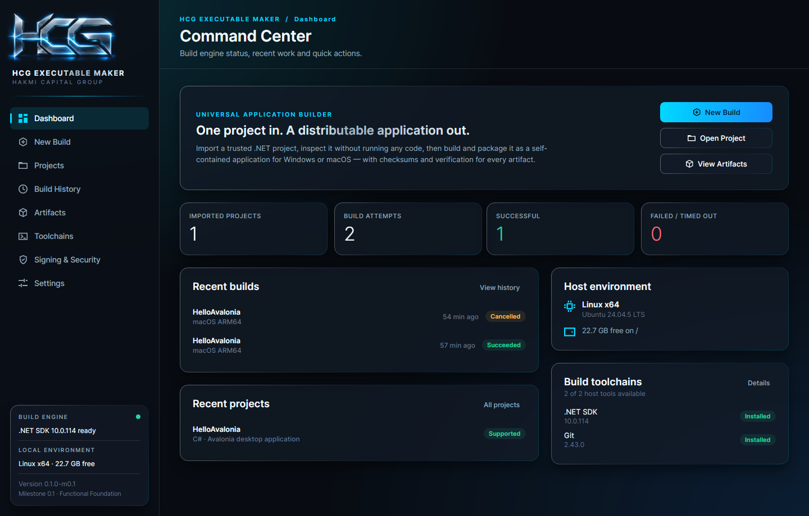
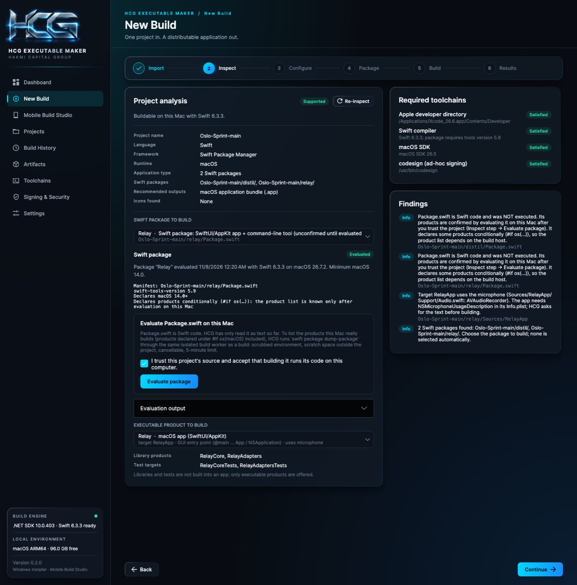
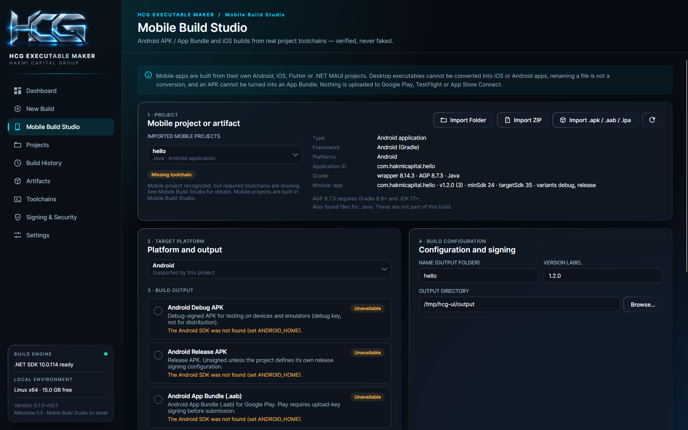

# HCG Executable Maker

[](https://github.com/F1r3srp3nt/HCG-Executable-Maker/actions/workflows/build.yml)

**Hakmi Capital Group · Software Engineering & Distribution Infrastructure**

> One project in. A distributable application out.

HCG Executable Maker imports a project (ZIP archive or folder), inspects it **without executing any of its code**,
builds it with the real toolchain, packages it for distribution, and verifies every artifact with SHA-256 checksums.

**Status: 0.3.0 pre-release — M0.1 Functional Foundation, M0.2 Windows installer, M0.5 Mobile Build Studio, native
Swift/macOS apps (SwiftPM → `.app`), and macOS distribution (Xcode selection, `.pkg`, Developer ID, notarization, Mac
App Store preparation; see docs/MACOS-DISTRIBUTION.md).**
.NET projects (including Avalonia desktop apps) can be built and packaged for **Windows** (portable or **Setup.exe
installer**), **macOS** and **Linux (portable preview)**; Android and iOS projects are built in **Mobile Build Studio**
(see below). See [`docs/STATUS.md`](docs/STATUS.md) for exactly what is and isn't implemented
and verified.



## What works today (M0.1)

| Area | Implemented |
|---|---|
| Import | ZIP archives and folders into isolated workspaces; rejects corrupt archives, path traversal, symlinks, duplicate entries, decompression bombs and oversize/over-count archives; preserves the original archive; never modifies your source |
| Inspection | Static .NET analysis: `.sln`, `.slnx`, `.csproj/.fsproj/.vbproj`, `Directory.Build.props`, central package versions, `global.json` roll-forward, target frameworks, output types, RIDs, package/project references, entry points, icons, Avalonia/WPF/WinForms/MAUI/web detection, platform compatibility |
| Node.js / Electron | Every `package.json` is classified (Electron desktop app, browser app, service, library). **Electron apps packaged with electron-builder are built** with the project's own workflow (see below); web-only projects get the exact list of what is missing |
| Other ecosystems | Rust, Python, Java, C/C++, React Native, Unity are **recognized and reported as unsupported** — never faked (Android/iOS/Flutter/MAUI: see Mobile Build Studio) |
| Build | `dotnet restore` → `build` → `publish` with structured arguments (no shell), Release/Debug, runtime selection (win/osx/linux × x64/arm64), self-contained, single-file, live log, warning/error parsing, cancellation, timeouts |
| Packaging | Portable folder · portable ZIP (Unix permissions preserved) · **Windows Setup.exe installer** (Inno Setup, Windows hosts — M0.2, see below) · macOS `.app` bundle (Info.plist, `.icns`, exec bits) · `.dmg` on macOS hosts with `hdiutil` |
| Verification | Executable present, PE/Mach-O/ELF format and CPU architecture, executable bit, bundle structure, code-signature presence, archive integrity, SHA-256 (+ per-file manifests for folders) |
| Icons | PNG/ICO/ICNS inspection (size, aspect, transparency), aspect-preserving ICO/ICNS generation, original never modified |
| History | SQLite with migrations: projects, builds, settings, messages, artifacts, checksums, toolchain versions; repeat builds, view logs, delete history, remove workspaces |
| Toolchains | .NET SDK, Git, OS/CPU, disk space; macOS (Xcode CLT, Xcode, codesign, hdiutil, notarytool, productbuild); Windows (Windows SDK, signtool, MakeAppx, MSBuild, WiX, Inno Setup). Never installs anything |
| Security | Explicit trust confirmation before every build; secrets scrubbed from the build environment; no credentials stored; signing capabilities reported honestly as **not implemented** |

## Windows installer (M0.2)

A standard **Setup.exe** built with Inno Setup 6: Start-menu shortcut, optional desktop shortcut, per-user or
all-users install, uninstaller in Settings → Apps, in-place upgrades. Requires a Windows build host with Inno Setup 6
and a self-contained build; from macOS/Linux use the Windows CI runner. Verified by really installing, launching and
uninstalling on Windows. Details: [`docs/WINDOWS-INSTALLER.md`](docs/WINDOWS-INSTALLER.md).

## Swift macOS apps (unreleased, `feature/swift-macos`)

Swift Package Manager packages are built into macOS apps on a Mac, through the normal New Build wizard:

1. Import a folder or ZIP.
2. Choose the package (e.g. `distil/` or `relay/`; never auto-selected).
3. Evaluate `Package.swift` on this Mac. This happens only after you confirm trust, through the build worker.
4. Pick the executable product (libraries and tests are listed separately).
5. Configure: display name, bundle id, build number, minimum macOS, privacy texts, arm64/x86_64/universal.
6. Build.

Outputs:
- **SwiftUI/AppKit** products become an ad-hoc-signed `.app`, optionally also as ZIP and DMG.
- **Command-line** products become a folder or ZIP.

Not offered on Windows/Linux. macOS Xcode projects are recognized but not built yet. Verified in CI by building and
launching Distil.app and Relay.app from the pinned Oslo-Sprint repository. Details:
[`docs/SWIFT-MACOS.md`](docs/SWIFT-MACOS.md).



## Electron desktop apps (unreleased, `feature/electron`)

Electron apps packaged with **electron-builder** are built through the New Build wizard:

1. Import a folder or ZIP, then choose the Electron app (nested projects included).
2. Inspection reads `package.json`, the lockfile and the electron-builder configuration without running anything. It
   shows what the project is and what is missing.
3. Build runs three stages:
   - `npm ci`;
   - the project's compile script (e.g. `npm run desktop:build`);
   - electron-builder with the project's configuration (`--publish never`).
4. The `.app` (and zip/dmg) or the Linux app folder are found and verified (signature, architecture, app.asar contents).

Offered on macOS (arm64/x64 `.app`, zip, dmg) and Linux (unpacked app). Details: [`docs/ELECTRON.md`](docs/ELECTRON.md).

## Mobile Build Studio (M0.5)

| Area | Implemented |
|---|---|
| Projects | Native Android (Gradle, Java/Kotlin), native iOS (Xcode), Flutter, .NET MAUI — detected statically; React Native/Unity recognized as unsupported |
| Android | Debug APK, release APK (unsigned / project signing / HCG local debug key), App Bundle (`.aab`) — through the project's own Gradle wrapper |
| AAB → APK | Universal or device-targeted APK sets with Google's bundletool, from a build or an imported `.aab` |
| iOS (Mac only) | Simulator build, `.xcarchive` (signed or unsigned), IPA export (`app-store-connect`, release testing, enterprise, development) — never uploaded |
| Verification | APK/AAB/APK set/IPA/xcarchive/.app: integrity, manifest/Info.plist metadata, ABIs/architectures, signing state, provisioning profile, SHA-256; `apksigner`, `bundletool validate`, `codesign` when installed |

Desktop executables are never "converted" into mobile apps, and APK → AAB is not offered (it is not possible).
Details: [`docs/MOBILE-BUILDS.md`](docs/MOBILE-BUILDS.md).



**Not yet implemented** (shown in the UI as *Planned*, never as working): Windows MSI (WiX — M0.2b) and MSIX,
Windows code signing (Authenticode), Linux AppImage/DEB/RPM,
store uploads of any kind, sandboxed build workers.

## Requirements

- **.NET 10 SDK** (to build HCG Executable Maker and to build the projects it imports)
- Windows 10+, macOS 11+ or a modern Linux desktop
- Network access to NuGet for package restore

## Download

Ready-to-run builds are produced by CI on real macOS, Windows and Linux machines — HCG Executable Maker packages
itself. Get them from the repository's **Releases** (tagged versions) or from the latest successful
**Actions → Build & Release** run (artifacts). They are unsigned pre-releases; see [`docs/TESTING.md`](docs/TESTING.md)
for first-launch steps.

## Build, run, test

```bash
dotnet build HCG.ExecutableMaker.slnx
dotnet run --project src/HCG.ExecutableMaker.App

# Unit tests only (fast, ~1 s)
HCG_SKIP_INTEGRATION=1 dotnet test

# Everything, including real end-to-end builds of tests/Fixtures/HelloAvalonia (~1–2 min, needs NuGet access)
dotnet test
```

Publish HCG Executable Maker itself:

```bash
dotnet publish src/HCG.ExecutableMaker.App -c Release -r osx-arm64 --self-contained   # or win-x64, osx-x64, linux-x64
```

App data lives in the per-user application-data folder (`HCG/ExecutableMaker`), or in
`$HCG_EXECUTABLE_MAKER_HOME` when that variable is set.

## Security model in one paragraph

Importing and inspecting are safe: nothing from the project runs. **Building is not sandboxed**: `dotnet restore/build`
executes MSBuild targets, analyzers and source generators from the project with your user's permissions. The app
explains this and requires an explicit acknowledgement before each build; credential-like environment variables are
removed from the build process. Only build projects you trust. Details: [`docs/SECURITY.md`](docs/SECURITY.md).

## Documentation

- [`docs/MOBILE-BUILDS.md`](docs/MOBILE-BUILDS.md) — Mobile Build Studio overview, output matrix, signing modes, CLI
- [`docs/ANDROID-BUILDING.md`](docs/ANDROID-BUILDING.md) · [`docs/IOS-BUILDING.md`](docs/IOS-BUILDING.md) ·
  [`docs/MOBILE-ARTIFACT-VERIFICATION.md`](docs/MOBILE-ARTIFACT-VERIFICATION.md)
- [`docs/WINDOWS-INSTALLER.md`](docs/WINDOWS-INSTALLER.md) — Windows Setup.exe: features, requirements, CI route, tests
- [`docs/ELECTRON.md`](docs/ELECTRON.md) — Electron apps: inspection, electron-builder stages, verification, offered targets
- [`docs/TOOLCHAINS.md`](docs/TOOLCHAINS.md) — toolchain discovery (Xcode, Java, Android SDK, Node.js) and readiness
- [`docs/TESTING.md`](docs/TESTING.md) — get a ready-to-run build (self-packaged) and test it on macOS/Windows
- [`docs/STATUS.md`](docs/STATUS.md) — what is complete, what is not, verification evidence, continuation instructions
- [`docs/ARCHITECTURE.md`](docs/ARCHITECTURE.md) — solution structure, data flow, extension points
- [`docs/SECURITY.md`](docs/SECURITY.md) — trust boundary, import hardening, secrets, signing roadmap
- [`docs/ENVIRONMENT-REPORT.md`](docs/ENVIRONMENT-REPORT.md) — the development environment M0.1 was built and verified in
- [`docs/HCG-MAIL-VALIDATION.md`](docs/HCG-MAIL-VALIDATION.md) — workflow for the first production validation (HCG Mail)
- [`CHANGELOG.md`](CHANGELOG.md)

## Branding

The app uses the founder-provided **temporary official HCG logo** (`branding/hcg-logo-temporary-original.png`,
kept unmodified). In-app assets — a transparent-background wordmark and a square app icon — are derived from it by
`tools/branding/make_logo.py`. To switch to the final logo, see [`branding/README.md`](branding/README.md).

© Hakmi Capital Group.
