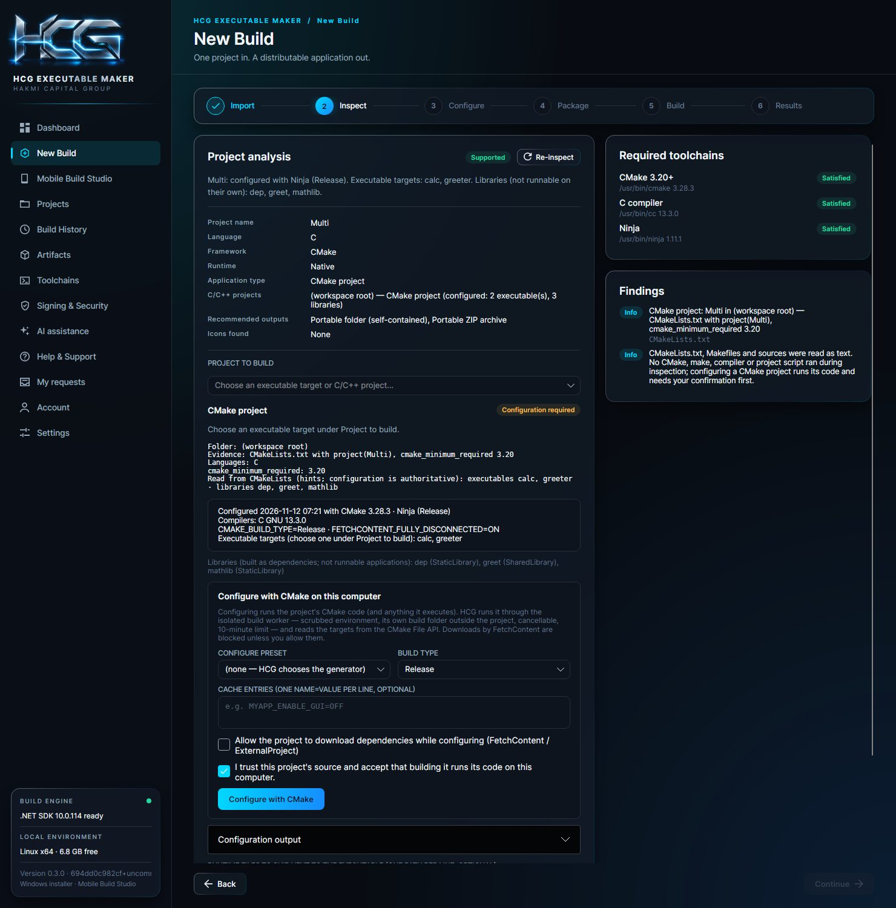
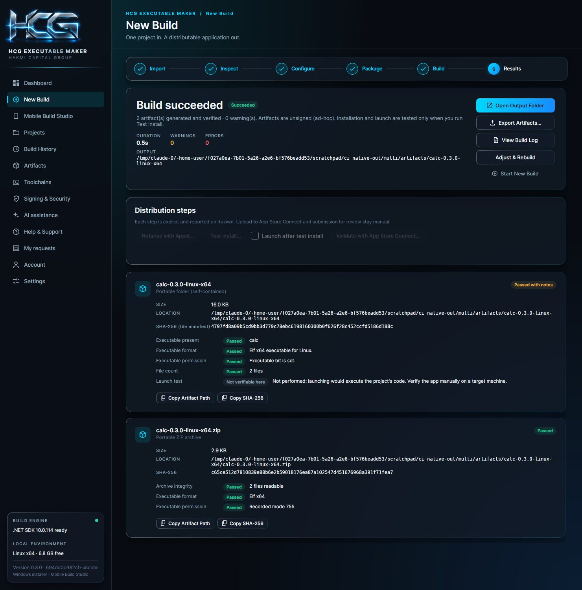
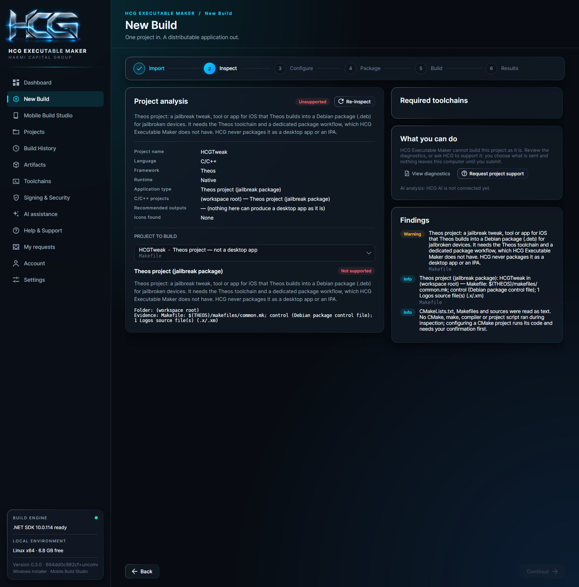

# C/C++ projects

HCG Executable Maker builds C and C++ projects through the normal **New Build** wizard (Import → Inspect → Configure →
Package → Build → Results). It builds **for the computer it runs on, with that computer's compilers**. This page
describes what is supported, how each step works and where the limits are.

## Supported project types

| Project | How HCG recognizes it | What HCG builds |
|---|---|---|
| **CMake** | `CMakeLists.txt` with `project()`; the topmost one in a folder tree is the project, nested ones are its subdirectories | Any **executable target** the project defines, read from the CMake File API after a trusted configure |
| **Make** | `GNUmakefile`, `makefile` or `Makefile` (not Theos, not generated by CMake/Autotools) | The **make target you name**, packaging the **output file you name** |
| **Sources without a build system** | `.c`/`.cpp`/`.cc`/`.cxx` files, at least one defining `main()` | The **files you select**, through a small CMakeLists.txt HCG generates in its own build folder |
| **Theos** | A Makefile including `$(THEOS)/makefiles/…`, Logos sources (`.x`, `.xm`), a Debian `control` file | **Nothing** — explained only (see below) |
| Meson, Autotools without a Makefile, Visual Studio `.vcxproj`/`.sln` only, Bazel, … | Their build files | **Nothing** — recognized and explained as not supported in this version |

Inside a repository, HCG skips dependency and build folders when looking for project roots: `build/`, `out/`,
`cmake-build-*`, `_deps/`, `third_party/`, `vendor/`, `external/`, `deps/`, `.theos/`, `node_modules/`, `.git/` and
similar. A vendored library that the project adds with `add_subdirectory(third_party/x)` is still read as part of that
project; it is just not offered as an application of its own.

When a folder also contains a `package.json`, `Package.swift` or a .NET project at the same or a higher level, the
C/C++ inspector scores lower, so a convenience Makefile in a Node/.NET/Swift project does not take over.

## Inspect

Inspection only **reads** files: `CMakeLists.txt`, `CMakePresets.json`/`CMakeUserPresets.json`, Makefiles and source
files. It never runs CMake, make, a compiler or a project script. From the text it shows:

- the project kind, folder, evidence, languages and `cmake_minimum_required`;
- `add_executable`/`add_library` names as **hints** (CMake configuration is authoritative), `find_package` names, and
  whether the project downloads dependencies (FetchContent / ExternalProject);
- for Make: the rule targets and `.PHONY` targets found in the Makefile.

### States

The C/C++ panel under *Project to build* always shows one state:

| State | Meaning |
|---|---|
| **Toolchain missing** | A tool this project needs is not installed (CMake 3.20+, a C or C++ compiler for its languages, Ninja or make, or on Windows the Visual Studio C++ tools). Each missing tool is listed with its install guidance. HCG never installs tools. |
| **Configuration required** | Something is still needed: configure the CMake project, choose an executable target, name the make target and its output, or select source files. The exact item is shown. |
| **Ready** | The build can start. |
| **Building** | A build of this project is running. |
| **Failed** | The last build of this target failed, timed out or was cancelled; the reason is shown. |
| **Verified** | The last build of this target succeeded and its artifacts passed verification. |
| **Not supported** | Theos and other unsupported build systems, with the reason. |

### CMake: trusted configure and real targets

Configuring a CMake project **runs the project's CMake code** (and anything it executes), so the
**Configure with CMake** button stays disabled until you confirm that you trust the project. Configuration then:

1. writes a CMake File API query (codemodel v2, toolchains v1, cache v2) into HCG's own build folder
   (`<HCG data>/native/<project>/<hash>/configure`, never inside the imported source);
2. runs `cmake -S <project> -B <HCG folder> …` through the same isolated build worker as a build: argument list (no
   shell), credentials scrubbed from the environment, cancellable, 10-minute limit, output streamed to the panel;
3. reads the File API reply: generator, single- or multi-configuration, configurations, compilers, important cache
   entries, and every target with its type, artifact paths, languages, source folder and dependencies.

Options before configuring:

- **Configure preset** from `CMakePresets.json` / `CMakeUserPresets.json` (hidden presets are not offered). With a
  preset, the preset's generator and cache variables are used; HCG still sets the build folder (`-B` overrides the
  preset's `binaryDir`).
- **Build type**: Release, Debug, RelWithDebInfo or MinSizeRel. Passed as `CMAKE_BUILD_TYPE` for single-configuration
  generators and as `--config` for multi-configuration generators (Visual Studio, Ninja Multi-Config, Xcode).
- **Cache entries**: `NAME=VALUE` or `NAME:TYPE=VALUE`, one per line, validated and passed as separate `-D` arguments.
- **Allow downloads**: off by default. HCG passes `FETCHCONTENT_FULLY_DISCONNECTED=ON`, so FetchContent uses only what
  is already available. If configuration fails because of that, the error says so.

Without a preset, HCG chooses the generator: Visual Studio (with `-A x64|ARM64`) on Windows when MSVC is installed,
otherwise Ninja when installed, otherwise Unix Makefiles (MinGW Makefiles on Windows). On a Mac it passes
`CMAKE_OSX_ARCHITECTURES` for the chosen architecture. HCG never overrides the project's own language standard,
compile flags or dependencies.

After configuring, *Project to build* lists **one entry per executable target** (`dir/CMakeLists.txt#target`). When
there are several, none is selected automatically. Libraries (static, shared, module, object, interface) are listed
separately in the panel as "not runnable applications" and are never offered as something to build. A project with
only libraries says so and cannot continue.

### Make: explicit target and output

HCG does not guess what a Makefile builds. You enter:

- the **make target** (the targets read from the Makefile are offered as buttons);
- the **expected output**: the file that target produces, relative to the project folder (for example `bin/myapp`, or
  `MyApp.app` for a Makefile that builds a macOS bundle);
- optional **make variables** (`NAME=VALUE`, validated, passed as separate arguments).

### Sources without a build system

You select exactly the files that make up one program (one `main()`), the language (C or C++), the standard
(C 99/11/17/23, C++ 11/14/17/20/23) and the executable name. HCG preselects the first file with `main()` and the
files without `main()` in the same folder; everything is your choice. The generated CMakeLists.txt is shown before the
build and written only to HCG's build folder. HCG never compiles every source file blindly.

## Configure (step 3)

- **Platform**: only this computer's platform is available. Others show "build on a <platform> computer with its
  toolchain". HCG does not imply that a Mac can build Windows or iOS binaries, or Linux build macOS binaries.
- **Architecture**: on a Mac, arm64, x86_64 or universal (arm64 + x86_64, which needs every dependency to be universal
  too); on Windows and Linux, the computer's own architecture only.
- Name, version (from `project(... VERSION x.y.z)` when present), identifier, output folder and time limit as for any
  build. The .NET configuration choice is hidden: the build type comes from the C/C++ panel.

## Build

The build uses the existing trusted-build flow. The trust confirmation on the Build step is required again, because
configuring and building run project code.

| Kind | Stages |
|---|---|
| CMake | Configure with CMake (in `<build>/native`, a fresh folder per build) → `cmake --build <folder> --target <target> --config <type> --parallel <n>` |
| Sources | Generated CMakeLists.txt in `<build>/native/generated` → configure → build the generated target |
| Make | Project folder copied to `<build>/native/make-src` → `make -C <copy> -j<n> <target> [VARS]` |

- Every process is started with an argument list; nothing is assembled into a shell command, and target names,
  presets, cache entries, variables and paths are validated first.
- Output streams live into the build log. Compiler, linker, CMake and make errors are parsed into structured messages
  with file and line (GCC/Clang, MSVC, `CMake Error at`, `undefined reference`, `make: ***`).
- Missing packages (`find_package` failures) and blocked downloads are reported with a hint; HCG does not install them
  or fetch anything you did not allow.
- Cancel and the time limit stop the whole process tree (make, the compiler, and anything they started).
- Nothing is written into the imported source. The build tree is deleted after a successful build.

## Packaging and verification

After the build, HCG locates the output (CMake: the File API artifact path for the chosen configuration; Make: the
expected output; a missing output fails the build with a precise message) and checks:

- **Executable image**: ELF (an executable or a position-independent executable with an interpreter), Mach-O
  `MH_EXECUTE`, or PE without the DLL flag. Static/shared libraries, object files and scripts are rejected.
- **Format and architecture** match the chosen target (including universal Mach-O).
- **Runtime libraries**, read without running the program (`readelf -d` on Linux, `otool -L`/`otool -l` on macOS):
  each needed library is classified as a system library, shipped with the app, or **external**. When the project's own
  shared libraries are shipped next to the executable but the binary has no `$ORIGIN` (Linux) or
  `@executable_path`/`@loader_path` (macOS) search path, the build reports a warning (`HCG-RUNTIME`): the app finds
  them only through `LD_LIBRARY_PATH`/`DYLD_LIBRARY_PATH`. The full list is written to `RUNTIME-DEPENDENCIES.txt`
  next to the executable. A binary is never called portable just because it compiled.

Outputs:

| Output | Contents |
|---|---|
| **Portable folder** | The executable, the project's own shared libraries (from the build), the runtime files you listed, `RUNTIME-DEPENDENCIES.txt` |
| **Portable ZIP** | The same folder, Unix permissions preserved |
| **macOS .app** (Mac only, when the target is a `MACOSX_BUNDLE` or the Makefile output is `Name.app`) | The project's own bundle, copied with `ditto` (Info.plist, resources, frameworks and symbolic links kept as built); then a **separate signing stage** |
| **ZIP of the .app** (Mac only) | `ditto -c -k --keepParent`, keeps the signature |

DMG, PKG, Windows installer, AppImage and Debian packages are shown as *not implemented for C/C++ builds* and cannot
be selected. GUI packaging is offered only where the project itself builds an app bundle; HCG does not wrap a
command-line executable into a fake `.app`.

**Signing** (macOS bundles only) is its own reported stage: ad-hoc by default (`codesign --force --deep --sign -`), or
Developer ID with the hardened runtime when chosen in Distribution, then `codesign --verify --deep --strict`.
Notarization is never part of the build. Executables on Linux and Windows are not signed by HCG, and the results say
so.

**HCG never runs or installs the produced program.** The launch check always reads "Not performed".

## Theos

A Theos project is a jailbreak tweak, tool or app for iOS that Theos packages into a Debian package for jailbroken
devices. HCG has no Theos workflow, so it recognizes the project (the `$(THEOS)` includes, Logos sources, the `control`
file), explains this and offers nothing to build. It is checked **before** the generic Makefile handling, so it is never
treated as a Make project, and HCG never packages a tweak as a desktop application or an IPA.

## Toolchains

The Toolchains page has a **C / C++** group: CMake (3.20 or later), Ninja, make (`make`/`gmake`, `mingw32-make` on
Windows), the C and C++ compilers (`cc`/`clang`/`gcc`, `c++`/`clang++`/`g++`) and, on Windows, the Visual Studio C++
tools (found with `vswhere`). On a Mac, HCG checks `xcode-select -p` before probing `/usr/bin/cc`, so a missing
Command Line Tools installation is reported instead of triggering Apple's install prompt.

## Verification

| What | Where | Result |
|---|---|---|
| 28 C/C++ tests (`tests/HCG.ExecutableMaker.Tests/NativeTests.cs`): classification, nested repositories, Theos, other build systems, configure arguments, validation, generated CMakeLists, output parser, image kinds, and **real builds**: C in paths with spaces (trust refusal first), C++ standard, multiple CMake executables with a project shared library, library-only refusal, Make target with a variable, missing output, compile error with file and line, cancellation, loose sources | Linux (local and CI); runs on macOS CI too | Passing on Linux |
| The real wizard (`tools/ui-driver --native`) with the fixtures: MultiTarget (configure → targets → build `calc`), CppHello, MakeHello, LooseSources, TheosTweak (explained), MacBundle (plain executable on Linux) | Linux, locally | Passing |
| CI job `native-cpp` on `ubuntu-latest` and `macos-latest`, including a universal `MACOSX_BUNDLE` `.app`, ad-hoc signing stage, ZIP and checks with `plutil`, `lipo`, `codesign` | GitHub Actions | Added; runs on the next push |

Fixtures: `tests/Fixtures/Native/` (CHello, CppHello, MultiTarget, LibOnly, MakeHello, BrokenC, TheosTweak,
LooseSources, MacBundle).

## Limits in this version

- Builds are for this computer only (no cross-compilation, no Android NDK or iOS builds here; for a Linux C/C++
  console program to Android, see Porting Studio).
- Re-inspect reads the files again and forgets an earlier configuration; configure again afterwards.
- HCG does not install compilers, CMake, Ninja, make, packages (`find_package`) or SDKs, and does not run
  package managers such as vcpkg or Conan for you. A project that uses them must have them set up already (for
  example through a preset that points at its toolchain file).
- Shared libraries outside the project (Qt, SDL, Boost, …) are reported, not bundled. List extra runtime files
  explicitly, or make the project install an `$ORIGIN`/`@executable_path` RPATH.
- Windows (MSVC and MinGW) builds are implemented but have not been verified on a Windows computer.
- macOS app bundles, universal builds and the signing stage are implemented and covered by the `native-cpp` CI job, but
  were not run on a Mac while this was written (the development host was Linux).
